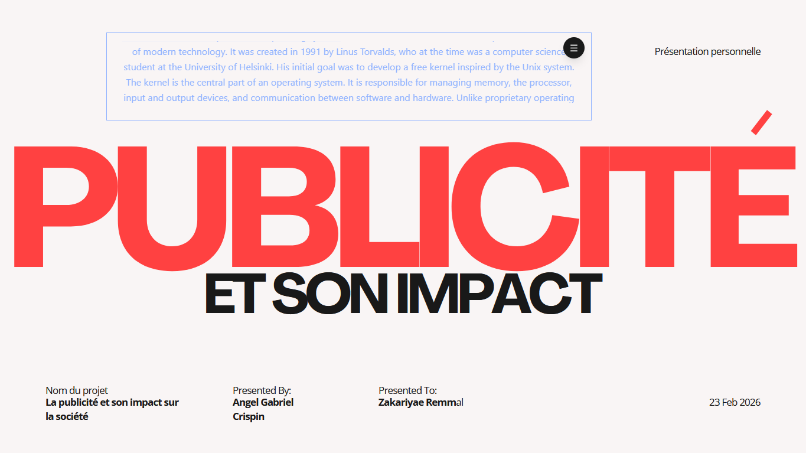
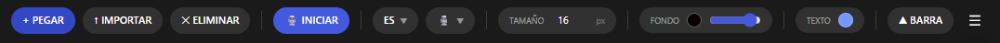
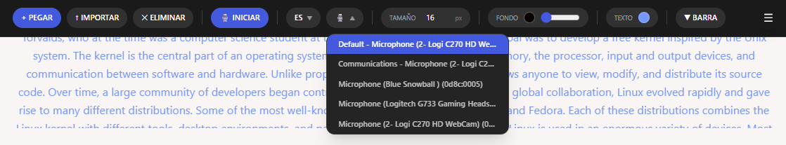
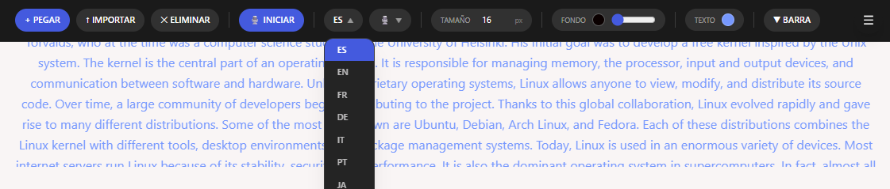

<div align="center">

# 🎙️ Vocal Teleprompter

**A teleprompter that listens to you and scrolls your script as you speak.**

No fixed speed, no foot pedal: talk at your own pace and the text follows your voice.
Invisible in Zoom, Meet and OBS, so only you can see it.

[](https://github.com/FaureGalliard/vocal-teleprompter/releases/latest)


[](LICENSE)

**[⬇️ Download the installer](https://github.com/FaureGalliard/vocal-teleprompter/releases/latest)** · [Features](#-features) · [Shortcuts](#%EF%B8%8F-keyboard-shortcuts) · [Development](#-development)



</div>

---

## ✨ Why Vocal Teleprompter

- **🎤 It follows your voice.** Speech recognition finds where you are in the script and
  scrolls there. Pause, speed up or ad-lib, and it waits for you.
- **🕶️ Hidden from screen sharing.** Zoom, Google Meet, Teams, OBS, Discord and screenshots
  leave the window out. Your audience sees your slides; you see your script.
- **◐ Always readable.** The text color is adjusted automatically to keep WCAG contrast
  with the background. With a see-through background the text gets a halo, so it stays
  legible over a video, slides or your desktop.
- **🪟 Sits on top of everything.** Always on top, see-through background, resizable, with
  no taskbar entry. It can live right under your webcam.

---

## 🧩 Features

- 🃏 **Slide cards**: put a line with `---` between slides and each part becomes a card.
  The current card stands out, the bottom bar shows *Slide 3 / 12*, and it moves on as
  soon as you say the last word of the slide.
- ⏱️ **Pace and time**: see how long the script takes before you start, then the elapsed
  time, words per minute and time left. Set a **target duration** (say 10 minutes) and it
  tells you to speed up or slow down.
- ⌨️ **Global shortcuts** that work while Zoom, Meet or your slides have the focus.
- 🖱️ **Click-through mode**: clicks pass through the window to the app behind it.
- 📏 **Reading line** (optional): the current line stays at a fixed height near your
  camera, with the text around it faded.
- 🔎 **Word-level sync**: fuzzy matching (edit distance) on the last few spoken words, so
  mispronounced or skipped words don't throw it off.
- 🌍 **9 languages**: Spanish, English, French, German, Italian, Portuguese, Japanese,
  Chinese and Korean. Scripts without spaces are split into words with `Intl.Segmenter`.
- 🖱️ **Click any word** to continue from there after you jump ahead or repeat a passage.
- 🎙️ **Microphone picker** that picks up devices you plug in while the app is open.
- 💾 **Remembers everything**: script, colors, opacity, size, language and microphone.
- 🎨 **Customizable look**: background color and opacity, text color and font size.
- ✍️ **Write right in the prompter**: press **EDIT** to type or fix the script in place,
  then **DONE** (or `Esc`) to go back to prompting.
- 📋 **Paste or import** your script from the clipboard or a `.txt` file. Line breaks are kept.
- 🌐 **Interface in the same 9 languages** (English by default), tray menu included.
- ⚙️ **Settings panel** behind the gear button: interface language, hiding from screen
  sharing, automatic contrast, click-through, reading line, target duration, title bar,
  the list of global shortcuts, and a reset to defaults.
- 🎓 **Guided tour** on first launch (replay it any time from Settings).
- 🧭 **Custom title bar** that you can move to the top or bottom, or hide.
- 🖥️ **System tray**: show, hide, toggle click-through or quit from the tray icon.

---

## ⌨️ Keyboard shortcuts

**Global** (work from any app):

| Keys | Action |
|---|---|
| `Ctrl+Alt+Space` | Start listening / pause / resume |
| `Ctrl+Alt+→` / `Ctrl+Alt+←` | Next / previous slide card |
| `Ctrl+Alt+H` | Show / hide the window |
| `Ctrl+Alt+K` | Click-through on / off |

**In the window:**

| Key | Action |
|---|---|
| `Space` | Start listening / pause / resume |
| `Esc` | Stop listening |
| `→` `↓` | Next word |
| `←` `↑` | Previous word |
| `PageDown` / `PageUp` | Next / previous slide card (10 words without cards) |
| `+` / `-` | Bigger / smaller text |

---

## 🎬 Demo

| Voice sync & highlighting | Easy resize | Color customization |
|---|---|---|
| [▶️ demo-voice-sync.mp4](docs/demo-voice-sync.mp4) | [▶️ demo-resize.mp4](docs/demo-resize.mp4) | [▶️ demo-color.mp4](docs/demo-color.mp4) |

| Toolbar | Microphone selector | Language selector |
|---|---|---|
|  |  |  |

---

## ⬇️ Download

Get the latest installer (`.exe` or `.msi`) from the
[Releases](https://github.com/FaureGalliard/vocal-teleprompter/releases/latest) page.

> **Windows SmartScreen**: the app is not code-signed yet, so Windows may warn you on the
> first launch. Click **More info → Run anyway**. The source is all here.

**Good to know**

- Speech recognition uses the engine built into Windows' WebView2 (the Web Speech API).
  It is free and needs no account, but it **needs an internet connection**.
- Hiding from screen capture needs **Windows 10 version 2004 or newer**. On older builds the
  window shows up black instead of disappearing. You can turn it off in **Settings** if
  you want to record the app itself.

---

## ⚙️ How it works

```
Microphone → Web Speech API → transcript
                                  ↓
             Intl.Segmenter → words, normalized (case, accents, punctuation)
                                  ↓
     Fuzzy matcher: last 3 spoken words vs. the next 25 words of the script
                                  ↓
          Nearest best match → highlight + smooth scroll to the current word
```

Each candidate word is scored by how many of the last spoken words line up with the
script before it. Ties go to the nearest word, so a repeated word further ahead can't make
the prompter jump. Short, common words only advance a step or two.

Contrast follows the WCAG 2 formula. When the text is below 4.5:1 against the background,
it is blended toward white or black just enough to pass and keeps its hue.

---

## 🚀 Development

Requirements: Node 22 + pnpm, Rust, and the
[Tauri prerequisites](https://tauri.app/start/prerequisites/).

```bash
pnpm install
```

```bash
pnpm tauri dev
```

Build the installers:

```bash
pnpm tauri build
```

They end up in `src-tauri/target/release/bundle/` (`nsis/*.exe` and `msi/*.msi`).

**Stack**: React 19 + TypeScript, Vite, Tailwind CSS v4, Framer Motion, Tauri 2 (Rust), and
the Web Speech API.

---

## 🎯 Use cases

YouTube videos · talks and presentations · video calls · podcasts · live streaming ·
recording courses

---

## 📄 License

[MIT](LICENSE)

## 👨‍💻 Author

Angel Gabriel Crispin Valdivia
