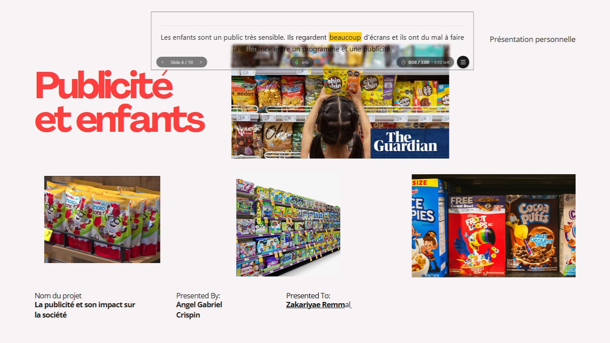
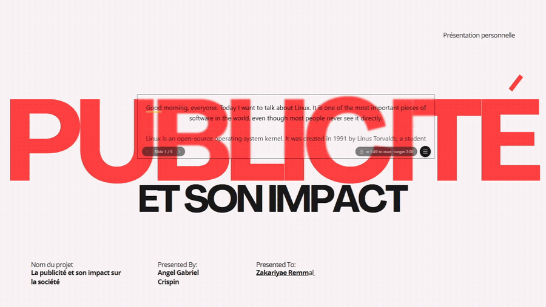
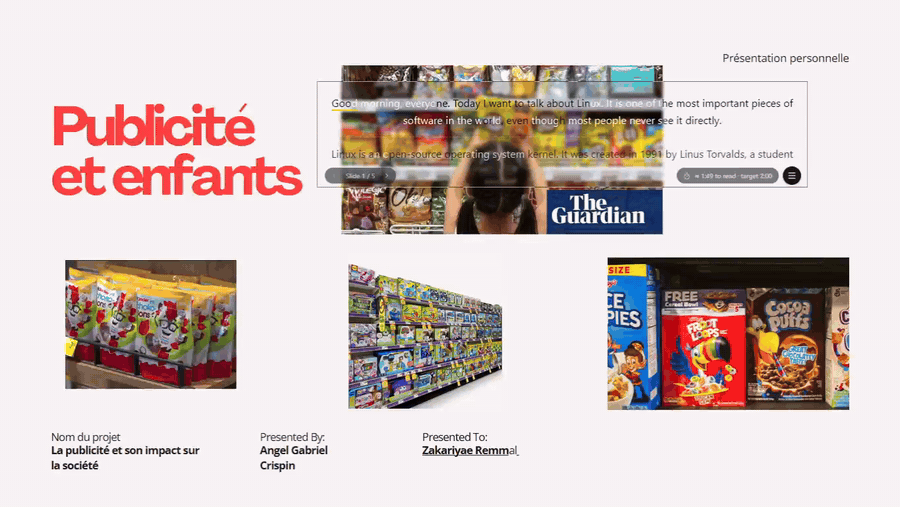
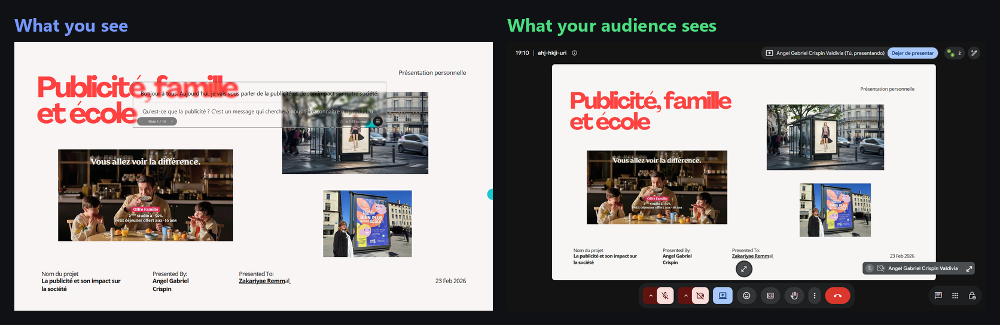
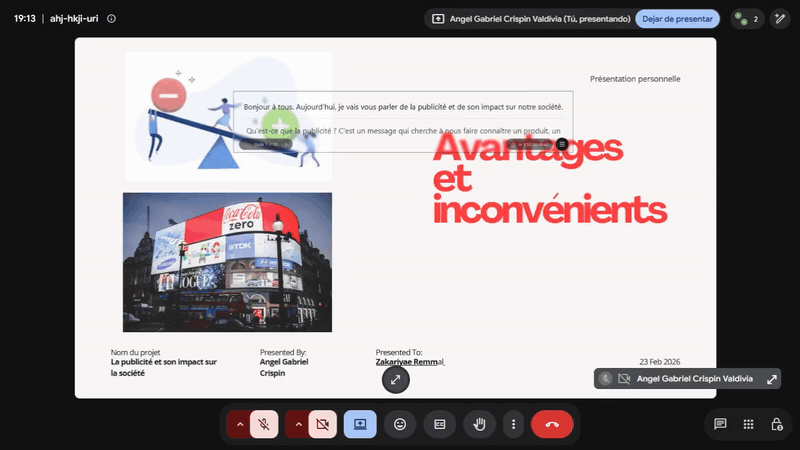
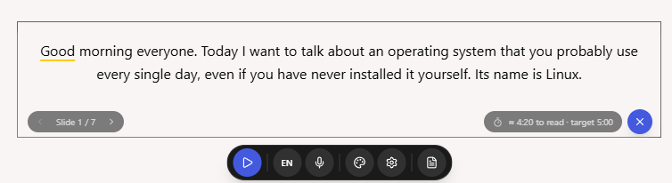

# Vocal Teleprompter

### A teleprompter that scrolls with your voice.

The script moves as you speak and waits when you pause. Keep it over your slides or right
under your webcam, and hide it from screen sharing if you want. Free, open source, and it
runs offline, on Windows and Linux.

## ⬇️ Download for [Windows](https://github.com/FaureGalliard/vocal-teleprompter/releases/latest/download/VocalTeleprompter-Setup.exe) · [Linux](https://github.com/FaureGalliard/vocal-teleprompter/releases/latest/download/VocalTeleprompter.AppImage)

---

## 🎤 It follows your voice

No fixed speed, no foot pedal. Speech recognition finds where you are in the script and
scrolls there, word by word. Pause, slow down or ad-lib, and it waits for you; skip a
sentence and it catches up, while a stray word that also comes later never sends it
jumping ahead. Works with any microphone, in 9 languages, entirely on your computer, with a
small offline speech model that leaves room for your call.

https://github.com/user-attachments/assets/81646d99-4438-4440-b3b0-1bccc8ea6e0a

## 🎨 It reads over anything

Put it wherever there is room on your slides, over photos, colors or text. What shows
through the window is frosted like glass, live, so a video or a window you drag stays soft
behind the text, and every letter takes the color that stands out most from what is right
behind it. You never pick a color or hunt for an empty corner.

Dragged across photos, the glass follows live

## 🕶️ Your audience never sees it

Share your screen and only your slides go out. On Windows, Zoom, Google Meet, Teams, OBS,
Discord and screenshots leave the prompter out, while you keep reading from it, right under
your webcam. On Linux, Wayland lets only the desktop hide a window, so on GNOME the
prompter's own Shell extension does it (see Download).

Turning it on in the middle of a Google Meet call

## 🤖 Ask Claude for your script

Ask *"Prepare a 2-minute talk about Linux, one card per slide"* and the script lands in the
prompter, split into slides and sized to your time. Connect Claude Desktop, Claude Code,
Cursor or VS Code in one click from **Settings → AI connector**.
[How it works →](docs/mcp.md)

https://github.com/user-attachments/assets/a4621cb4-0d02-4508-ba94-87fa80212288

## 🧰 Everything else a speaker needs

- 🃏 **Slide cards**: put `---` between slides; it moves to the next one as you finish.
- ⏱️ **Pace**: time left, words per minute, and a nudge to speed up or slow down.
- ⏳ **Countdown** before it starts listening, so you can look at the camera.
- 🧊 **Frosted glass**, drawn live behind the window: soften it as much as you like.
- 📚 **Your scripts in a library**: switch between them, nothing is lost as you edit.
- 🪟 **Stays where you put it**: always on top, remembers its size and spot.
- ⌨️ **Global shortcuts** that work while Zoom or your slides have the focus.
- 🖱️ **Click-through**, so clicks reach the app behind the prompter.
- 🔄 **Updates itself** in one click.

[Every feature and shortcut →](docs/features.md)

---

## ⬇️ Download

**[Download for Windows](https://github.com/FaureGalliard/vocal-teleprompter/releases/latest/download/VocalTeleprompter-Setup.exe)**,
run it, and you're done: the app updates itself from then on. The `.msi` and older versions
are on the [Releases](https://github.com/FaureGalliard/vocal-teleprompter/releases/latest)
page.

> **Windows SmartScreen** may warn you because the installer is not code-signed yet:
> **More info → Run anyway**. The source is all here.

**Linux:** the [AppImage](https://github.com/FaureGalliard/vocal-teleprompter/releases/latest/download/VocalTeleprompter.AppImage),
or the `.deb` or `.rpm` from the
[Releases](https://github.com/FaureGalliard/vocal-teleprompter/releases/latest) page. On
GNOME, also install the extension from the same release, which lets the prompter see
behind its window and hide from screen sharing; the
[extension's README](linux/gnome-shell-extension/README.md) says how.

macOS is next, see the roadmap.

## 🗺️ Roadmap

- 🍎 **macOS**
- 🐧 **Linux** on the AUR and Flathub
- 🪟 **winget** and the **Microsoft Store**
- 🎨 **A fresh look** for the interface

Have an idea? [Open an issue](https://github.com/FaureGalliard/vocal-teleprompter/issues).

## 💜 Support the project

If it saved you time before a talk or a recording:

- ⭐ **Star the repo**, it's what helps other people find it.
- 💜 **[Sponsor it on GitHub](https://github.com/sponsors/FaureGalliard)**: it pays for the
  Linux and macOS builds and for code signing.
- 📣 **Share it** with someone who has a presentation coming up.

---

[Contributing](CONTRIBUTING.md) · [MIT License](LICENSE) · Made by Angel Gabriel Crispin Valdivia
